# Launcher TV

Un accueil épuré pour les TV et boîtiers **Android TV / Google TV**, codé en vibe coding avec Claude.
Sans pub, avec une recherche qui fouille toutes les plateformes disponibles en Belgique,
l'agenda familial et une app sur le téléphone qui sert de télécommande.

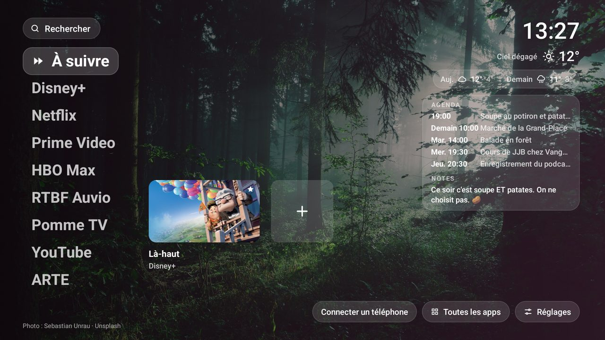

L'histoire du projet : [J'ai codé l'accueil de ma TV… sans savoir coder](https://www.entrelasoupeetlespatates.com/launcher-android-tv-sans-pub/) (Entre la soupe et les patates).

> Projet personnel, testé sur une Philips 55OLED855 (Android TV 9). Il devrait marcher sur la plupart des
> TV Android TV et Google TV, sans garantie. Les TV LG (webOS) et Samsung (Tizen) ne sont pas compatibles.

## Ce que ça fait

**Sur la TV**
- Une colonne d'apps en grand texte sur un fond d'écran (5 fonds jour/nuit, ta photo, ou une photo Unsplash), l'heure, la météo.
- **À suivre** : ce que tu as commencé dans chaque app, et tes favoris.
- **Agenda et notes** : n'importe quel calendrier iCal, et des petits mots laissés depuis le téléphone.
- **Minuteur** affiché par-dessus les apps.
- **Espace enfants** : extinction programmée (dans X minutes, à heure fixe, à la fin de l'épisode), code au rallumage, et **défis** (calculs, mots et phrases en néerlandais et en français) qui mettent la vidéo en pause.
- Réglages en deux colonnes, avec un accès direct aux réglages d'Android.

**Sur le téléphone** (une page web, à ajouter à l'écran d'accueil)
- Télécommande avec pavé tactile, volume, raccourcis d'apps, et un vrai **clavier** qui écrit dans l'app ouverte sur la TV.
- **Recherche unifiée** : films, séries (et sur quelle plateforme ils sont disponibles en Belgique), YouTube, apps.
- **À regarder** : nouveautés, films à revoir, séries à rattraper, cinéma coréen, à voir en famille, avec l'âge et les contenus signalés. Cartes à swiper pour affiner les suggestions.
- Réglages : favoris, enfants, écran d'accueil, apparence, apps, clés API.

## En images

| | |
|---|---|
| 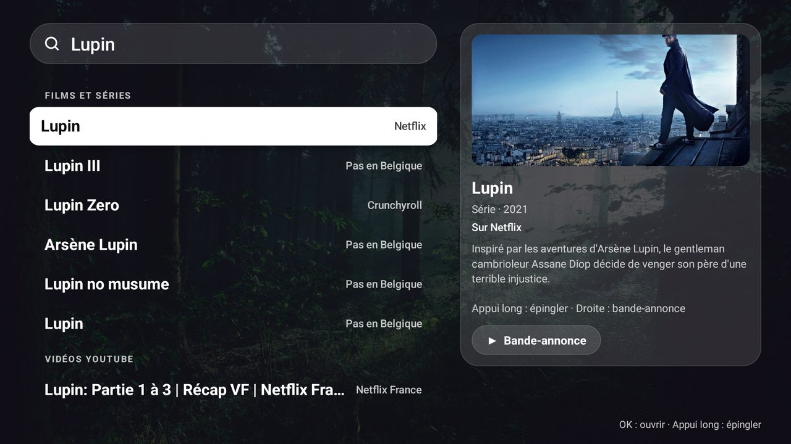 | 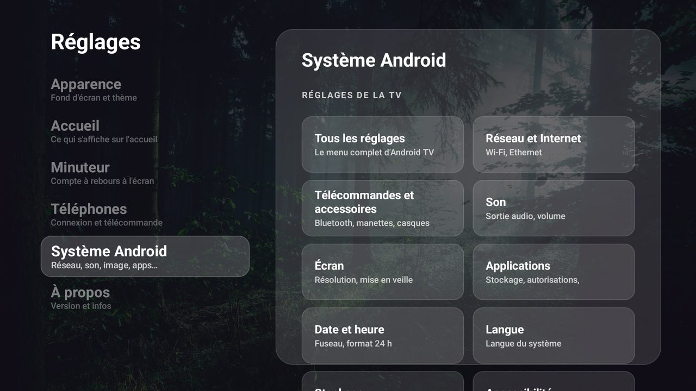 |
| Une recherche, toutes les plateformes belges | Les réglages, et un raccourci vers ceux d'Android |
| 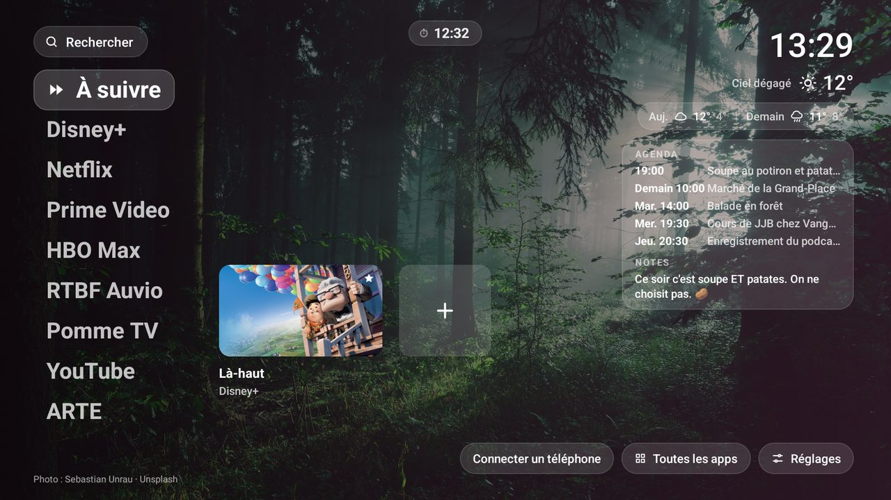 | 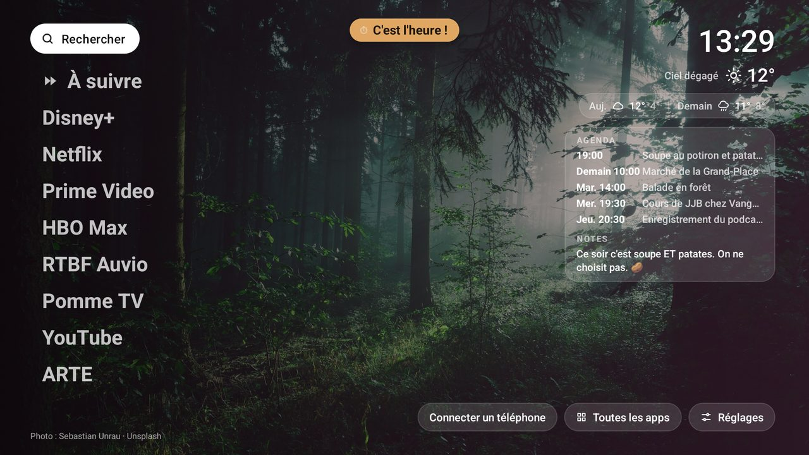 |
| Le minuteur reste discret, en haut | Et prévient quand c'est l'heure, sans prendre tout l'écran |
| 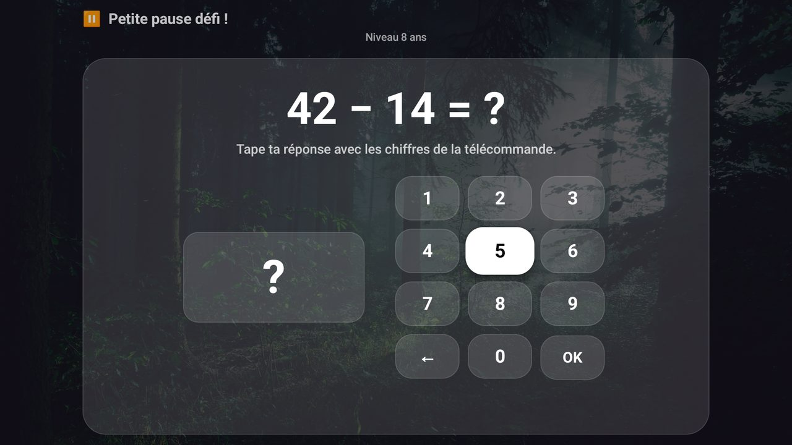 | 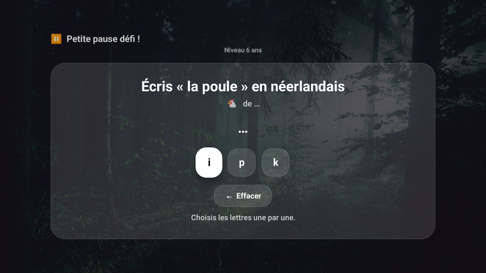 |
| Défi de calcul, réponse avec les chiffres de la télécommande | Défi de néerlandais, lettre par lettre |

**Sur le téléphone**

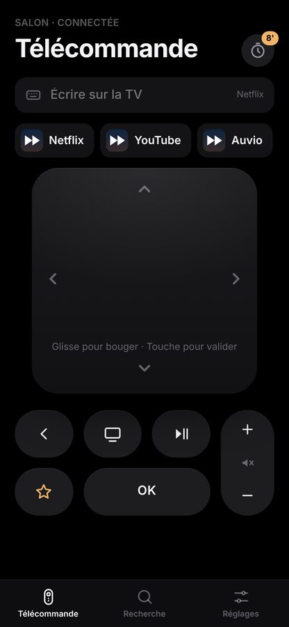
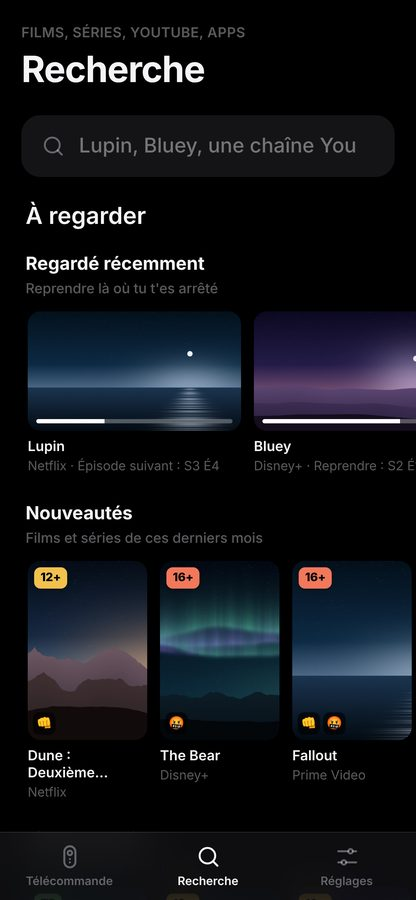
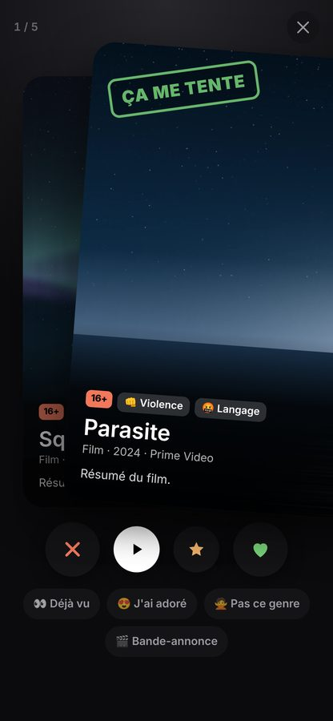
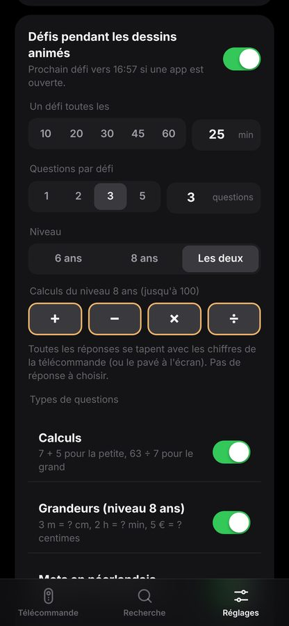
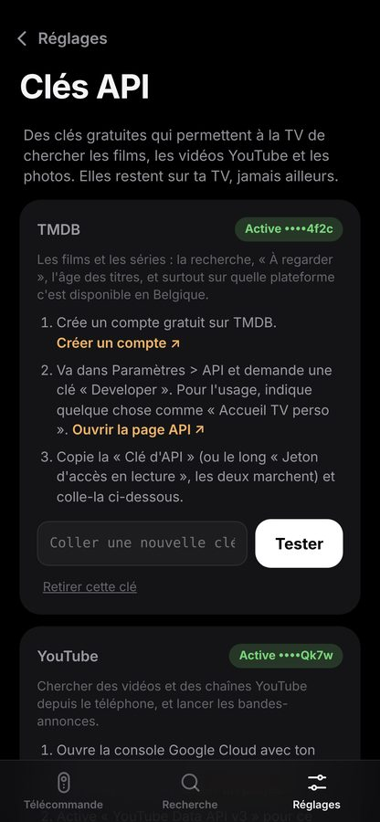

Captures en mode démo (faux agenda). Photo de fond : Sebastian Unrau sur <a href="https://unsplash.com">Unsplash</a>.

## Installation (Mac)

1. Télécharge ce dépôt, ouvre le Terminal dans le dossier.
2. `bash setup.sh` : installe Java, Gradle et les outils Android (15 à 20 minutes, une seule fois).
3. Sur la TV : Paramètres > Préférences de l'appareil > À propos, appuie 7 fois sur « Build »,
   puis active le **débogage USB** dans les options pour les développeurs.
4. `bash installer.sh` : demande l'adresse IP de la TV (Paramètres > Réseau), compile et installe.
   Accepte la demande « Autoriser le débogage ? » sur la TV.
5. Sur la TV, choisis « Connecter un téléphone » et scanne le QR code. Le téléphone te guide pour coller tes clés.

### Sans Mac : la version toute prête

1. Sur la TV : Paramètres > Préférences de l'appareil > À propos, appuie 7 fois sur « Build »,
   puis active le **débogage USB** (il sert à la télécommande du téléphone).
2. Télécharge [launcher-tv.apk](https://github.com/almereca/launcher-tv/releases/latest/download/launcher-tv.apk) (sans clé) et copie-le sur une clé USB.
3. Installe l'app gratuite **X-plore** sur la TV (le lecteur USB intégré n'ouvre pas les applis).
4. Branche la clé, ouvre le fichier avec X-plore et installe-le (autorise X-plore à installer des apps quand la TV le demande).
   Sans clé USB : l'app **Send Files to TV**, sur la TV et le téléphone, envoie le fichier sans fil.
5. Paramètres > Préférences de l'appareil > **Accessibilité** : active « Launcher » (c'est ce qui redirige le bouton Accueil).
6. Paramètres > Applications > Accès spécial aux applications > **Superposition** : active « Launcher » (pour le minuteur).
7. Sur la TV, choisis « Connecter un téléphone », scanne le QR code, et colle tes clés.

Les noms des menus varient un peu selon la marque. Avec un ordinateur et adb, `adb install launcher-tv.apk` marche aussi
(les étapes 5 et 6 restent à faire à la main).

### Les clés API (gratuites)

| Service | Pour quoi | Où la créer |
|---------|-----------|-------------|
| TMDB (indispensable) | Films, séries, disponibilité en Belgique, âges | [themoviedb.org/settings/api](https://www.themoviedb.org/settings/api) |
| YouTube Data v3 (facultatif) | Recherche YouTube, bandes-annonces | [Console Google Cloud](https://console.cloud.google.com/apis/library/youtube.googleapis.com) |
| Unsplash (facultatif) | Photos en fond d'écran | [unsplash.com/developers](https://unsplash.com/developers) (Access Key seulement) |

Colle-les depuis le téléphone (guide de démarrage, ou Réglages > Clés API), ou dans `secrets.properties` avant de compiler.
Elles restent sur ta TV. **Ne publie jamais un APK compilé avec tes clés** : utilise `bash build-apk-public.sh`.

### Revenir en arrière

`bash revenir-accueil-philips.sh` remet l'accueil d'origine et désinstalle le launcher.

## Scripts

| Script | Rôle |
|--------|------|
| `setup.sh` | Installe les outils (une fois) |
| `installer.sh` | Compile et installe sur la TV |
| `revenir-accueil-philips.sh` | Accueil d'origine |
| `code-enfants.sh` | Affiche le code de l'espace enfants, ou déverrouille (`--deverrouiller`) |
| `captures.sh` | Captures d'écran en mode démo (faux agenda, photo Unsplash) |
| `build-apk-public.sh` | APK à partager, sans aucune clé |
| `verifier-avant-publication.sh` | Vérifie qu'aucune donnée perso ne part sur GitHub |

## Limites connues

- Impossible d'épingler un film depuis l'intérieur de Netflix (l'app ne dit pas à la TV ce qu'elle affiche).
- Les liens directs vers un titre marchent pour Netflix, et selon les cas pour Disney+, Prime Video et Max. Sinon l'app s'ouvre simplement.
- Pas de « bientôt retiré du catalogue » : aucune source ouverte ne le fournit.
- La météo et le lever du soleil (thème automatique) sont réglés sur Mons : change les coordonnées dans `Weather.kt`.
- Sur les boîtiers Google TV, certaines mises à jour de Google peuvent ramener l'accueil d'origine sur le bouton Accueil.

## Crédits

- Données de films et séries : [TMDB](https://www.themoviedb.org). *This product uses the TMDB API but is not endorsed or certified by TMDB.*
- Disponibilité sur les plateformes : données [JustWatch](https://www.justwatch.com), via TMDB.
- Identifiants des plateformes : [Wikidata](https://www.wikidata.org).
- Photos : [Unsplash](https://unsplash.com), avec le crédit du photographe affiché.
- Météo : [Open-Meteo](https://open-meteo.com).

Projet indépendant, sans lien avec Philips, Google, Netflix ni aucune plateforme citée.

## Licence

MIT, voir [LICENSE](LICENSE).
